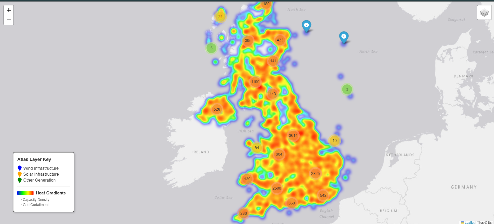

# UK Renewable Energy Atlas — REPD GIS Heatmap

A Python pipeline that turns the UK Government's Renewable Energy Planning Database (14,274 operational sites) into an interactive map showing where generation capacity and grid constraints concentrate. Built during a data internship at Fluxero to inform siting decisions for modular hydrogen plants.

**Data:** download the latest REPD extract from GOV.UK ("Renewable Energy Planning Database: quarterly extract"), then run `ingest_repd.py` followed by `generate_heatmap.py`.

## How it works

The pipeline ingests UK government renewable energy data, converts British National Grid coordinates into standard GPS, and generates a layered, interactive Folium map. Heatmap intensity is normalised against the 95th percentile of capacity, so hotspots reflect relative concentration rather than raw totals.

## Integration specification

- **Inputs:** REPD raw CSV data (UK Gov), pandas data structures.
- **Outputs:**
  1. `index.html` (presentation layer): interactive map with a capacity heatmap, a grid-constraint overlay, and colour-coded generation sites with pop-up details.
  2. `data/repd_atlas_ready.geojson` (integration layer): machine-readable spatial data for downstream use, with properties `Site Name`, `Technology Type`, `Installed Capacity (MWelec)`, `Curtailment_MWh` and `Constraint_Score`.
- **Dependencies:** pandas, geopandas, folium (full list in `requirements.txt`).
- **Integration notes:** this repo is one subsystem of Fluxero's wider internal Atlas platform, which isn't public. The map can be embedded in a dashboard via an iframe, or the GeoJSON passed to other spatial tools.

## Deployment instructions

1. Clone the repository.
2. Create a virtual environment and run `pip install -r requirements.txt`.
3. Download the REPD data (see above) and run `python ingest_repd.py`.
4. Run the map generator: `python generate_heatmap.py`, then open `index.html`.